# TP 3 : Service REST Calculatrice avec Jakarta EE (JAX-RS)

**Faculté des Sciences de Sfax** · Département d'Informatique et des Communications · 2025-2026
**Matière** : Architecture SOA et services Web · **Filière** : LSI3
**Réalisé par** : Salima Fourati

---

## Table des matières

1. [Objectifs](#1-objectifs)
2. [Rappel théorique : REST](#2-rappel-théorique--rest)
3. [Architecture globale](#3-architecture-globale)
4. [Environnement technique](#4-environnement-technique)
5. [Structure du projet](#5-structure-du-projet)
6. [Étapes de réalisation](#6-étapes-de-réalisation)
7. [Description de l'API](#7-description-de-lapi)
8. [Tests Postman](#8-tests-postman)
9. [Conclusion](#9-conclusion)

---

## 1. Objectifs

- Comprendre la conception d'une API REST selon les principes du cours.
- Créer un service REST en Java avec **JAX-RS** (Jakarta RESTful Web Services).
- Utiliser **Jersey** comme implémentation JAX-RS.
- Structurer un projet **Maven** (packaging `.war`).
- Déployer le projet dans **Tomcat**.
- Manipuler les annotations REST : `@Path`, `@GET`, `@QueryParam`, `@Produces`, etc.
- Tester les endpoints avec **Postman**.

**Contexte** : développer un service REST Calculatrice proposant l'addition, la soustraction, la multiplication et la division.

---

## 2. Rappel théorique : REST

**REST** (*REpresentational State Transfer*) est un style d'architecture pour concevoir des services web, proposé par Roy Fielding dans sa thèse en 2000. Il définit comment des systèmes distribués communiquent via HTTP.

### 2.1 Les principes fondamentaux

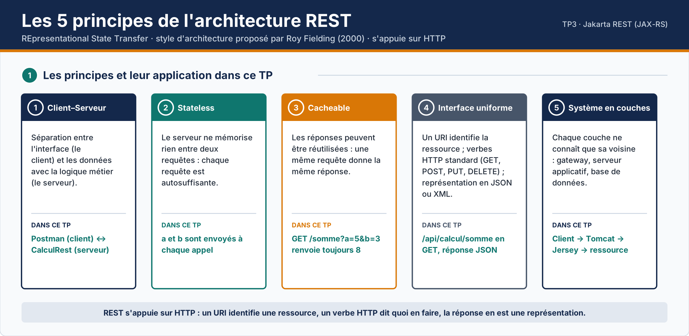

| Principe | Signification | Application dans ce TP |
|---|---|---|
| **Client–Serveur** | Séparation interface / logique métier | Postman (client) ↔ `CalculRest` (serveur) |
| **Stateless** | Le serveur ne mémorise rien entre deux requêtes | `a` et `b` sont envoyés à chaque appel |
| **Cacheable** | Une même requête donne la même réponse | `GET /somme?a=5&b=3` renvoie toujours 8 |
| **Interface uniforme** | URI + verbes HTTP + représentations standard | `/api/calcul/somme` en GET, réponse JSON |
| **Couches** | Chaque couche ne connaît que sa voisine | Client → Tomcat → Jersey → ressource |

### 2.2 REST vs SOAP

| Caractéristique | SOAP | REST |
|---|---|---|
| Protocole | XML, via HTTP, SMTP… | Principalement HTTP |
| Format des messages | XML (rigide, enveloppe SOAP) | JSON, XML ou autre (souple) |
| Complexité | Élevée (WSDL, contrat fort) | Simple (URI, méthodes HTTP) |
| Architecture | RPC (appels de fonctions distants) | Ressources identifiées par URI |
| Transport | Multi-protocoles | Majoritairement HTTP |
| État | Souvent stateful | Stateless |

### 2.3 Verbes HTTP

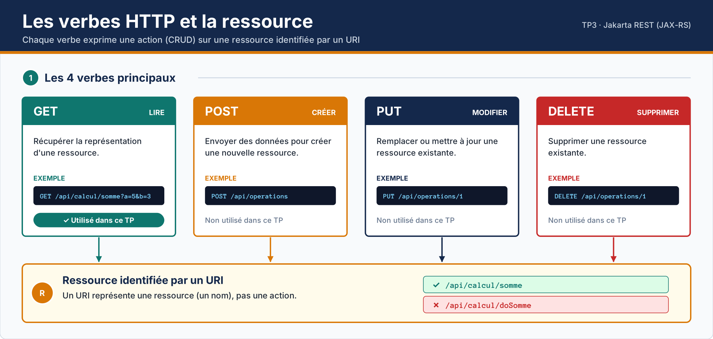

> Un URI représente une **ressource** (un nom), pas une action : on écrit `/api/calcul/somme` et non `/api/calcul/doSomme`.

### 2.4 Anatomie d'une requête et d'une réponse

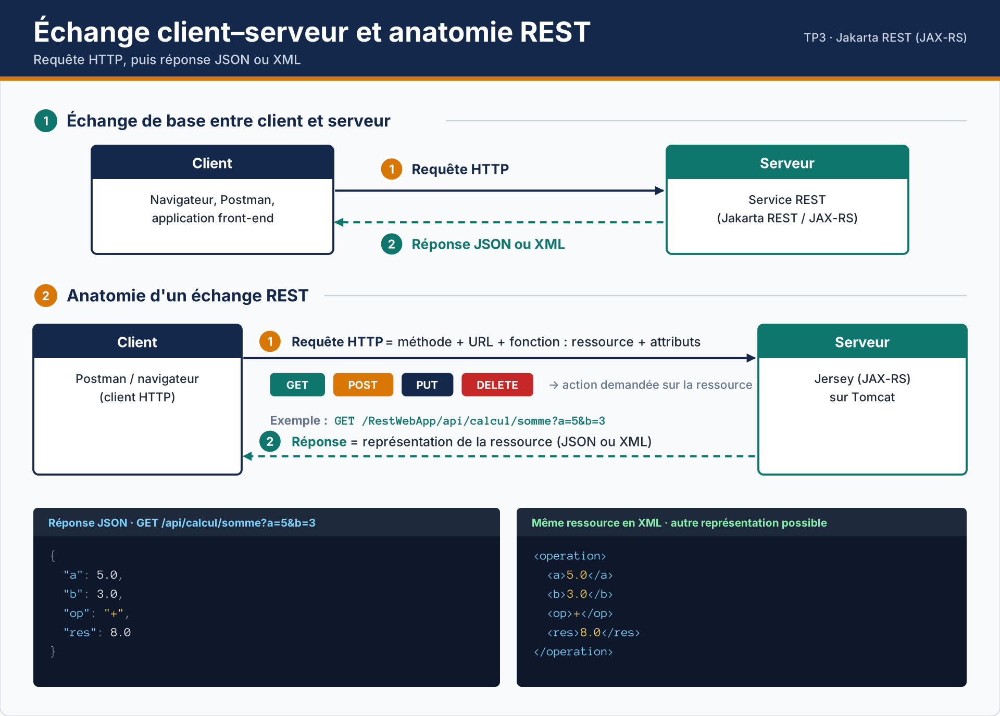

Exemple de réponse JSON : `{ "a": 5.0, "b": 3.0, "op": "+", "res": 8.0 }`.
Le même contenu en XML contient les balises `<operation>`, `<a>`, `<b>`, `<op>` et `<res>`. Le client choisit le format avec l'en-tête `Accept: application/json`.

---

## 3. Architecture globale

### 3.1 Vue d'ensemble : client → Tomcat → Jersey → ressource → classe métier

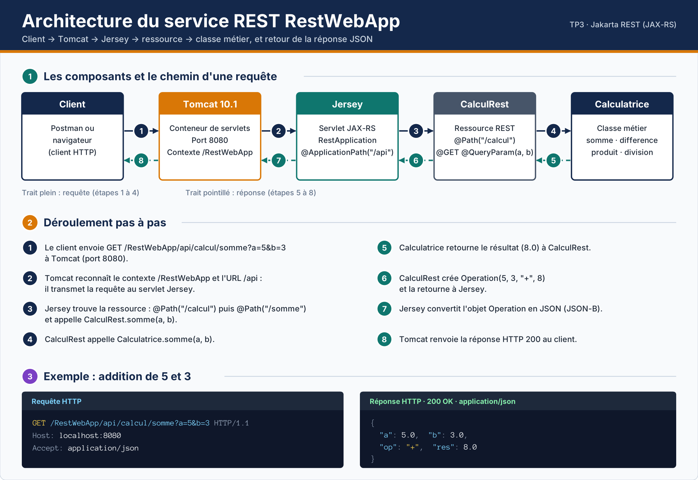

### 3.2 Rôle de chaque composant

| Composant | Rôle |
|---|---|
| **Tomcat** | Serveur web Java. Gère la couche HTTP (connexions, requêtes, réponses). Ne comprend **pas** les annotations JAX-RS. |
| **Jersey** | Implémentation de JAX-RS. Sa servlet fait le pont entre HTTP brut et le code Java : mapping des URI, méthodes HTTP, conversion JSON/XML. |
| **`jakarta.ws.rs-api`** | Interfaces et annotations seulement (`@Path`, `@GET`…). C'est une spécification, pas un moteur. |
| **`RestApplication`** | Active JAX-RS avec `@ApplicationPath("/api")`. |
| **`CalculRest`** | Ressource REST : expose les endpoints. |
| **`Calculatrice`** | Classe métier : effectue les calculs. |
| **`Operation`** | Modèle de données renvoyé au client (converti en JSON). |

| Fonction | Tomcat seul | Tomcat + Jersey |
|---|---|---|
| Reçoit des requêtes HTTP | ✅ | ✅ |
| Exécute des servlets | ✅ | ✅ |
| Comprend `@Path`, `@GET`, `@POST` | ❌ | ✅ |
| Sérialise en JSON / XML | ❌ | ✅ |
| Crée des API RESTful | ❌ | ✅ |

### 3.3 Diagramme de classes

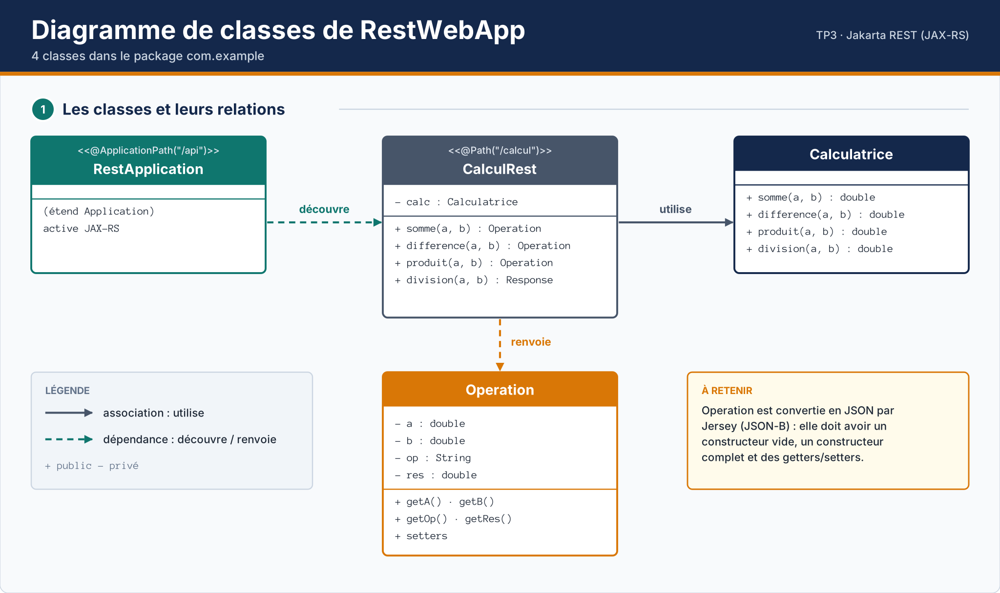

---

## 4. Environnement technique
| Étape | Outil / Technologie |
|---|---|
| **1. Création du projet Maven** | JDK, Maven, IntelliJ IDEA |
| **2. Configuration JAX-RS** | `jakarta.ws.rs-api` |
| **3. Classe métier** | Java |
| **4. Modèle JSON** | `jersey-media-json-binding` (JSON-B) |
| **5. Ressource REST** | Jersey (`jersey-container-servlet`, `jersey-hk2`) |
| **6. Déploiement** | Apache Tomcat |
| **7. Tests** | Postman |
| **Livraison** | Git / GitHub |
---

## 5. Structure du projet

```
CalculatriceREST/
├── pom.xml
└── src/
    └── main/
        └── java/
            ├── Calculatrice.java     ← logique métier
            ├── Operation.java        ← modèle JSON
            ├── CalculRest.java       ← ressource REST
            └── RestApplication.java  ← activation JAX-RS
```

**Capture : arborescence du projet dans IntelliJ**

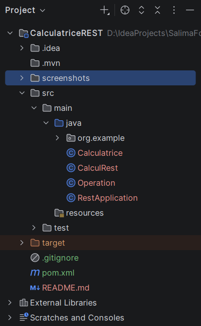

---

## 6. Étapes de réalisation

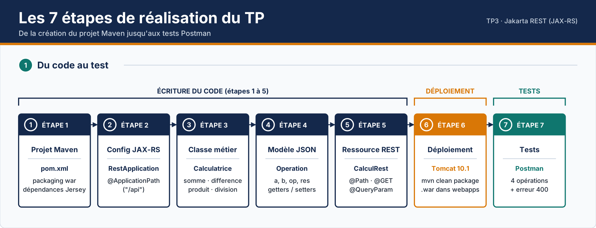


### Étape 1 : Création du projet Maven

Projet Maven de type `war`, avec le groupId `com.example` et l'artifactId `CalculatriceREST`.

**Points clés du `pom.xml`**

| Élément | Rôle |
|---|---|
| `<packaging>war</packaging>` | Application web déployable sur Tomcat |
| `jakarta.ws.rs-api` 3.1.0 | Annotations JAX-RS (`@Path`, `@GET`…) |
| `jersey-container-servlet` 3.1.4 | Intégration de Jersey avec le conteneur de servlets |
| `jersey-media-json-binding` 3.1.4 | Conversion objets Java ↔ JSON |
| `jersey-hk2` 3.1.4 | Injection de dépendances, requise par Jersey 3 |
| `<finalName>CalculatriceREST</finalName>` | Nom du `.war`, donc contexte `/CalculatriceREST` |
| `failOnMissingWebXml=false` | Pas besoin de fichier `web.xml` |

**Capture : `pom.xml` dans IntelliJ**


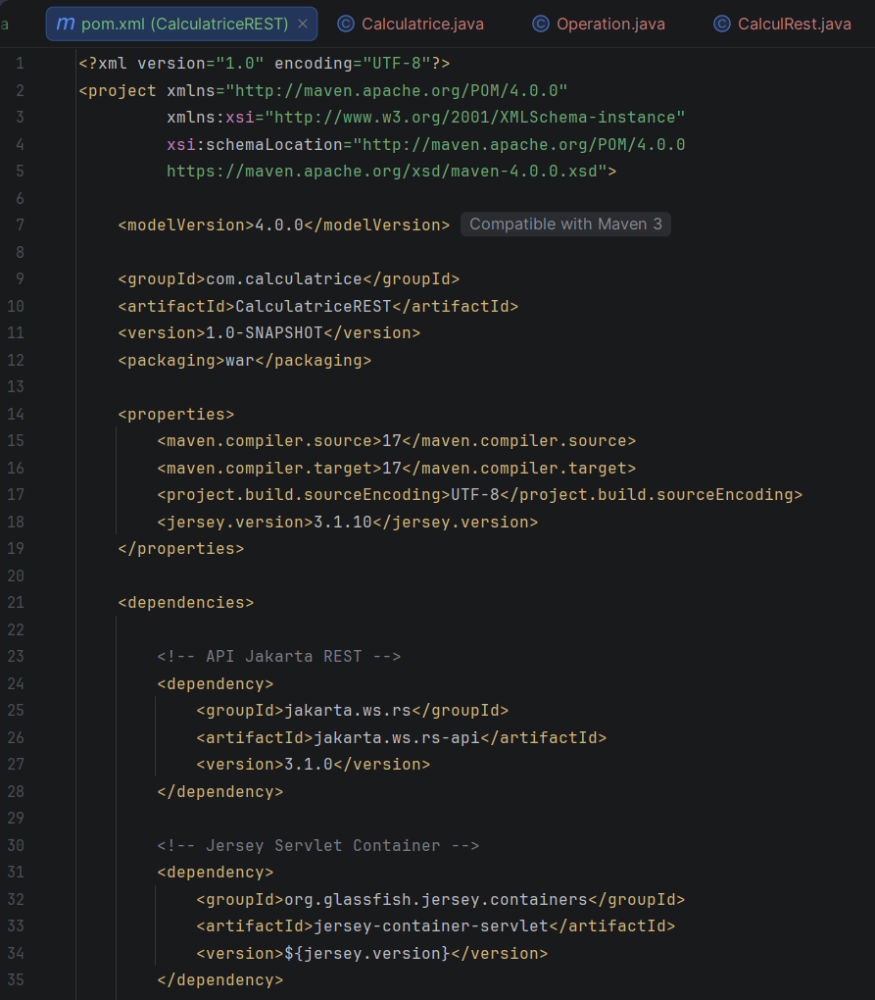
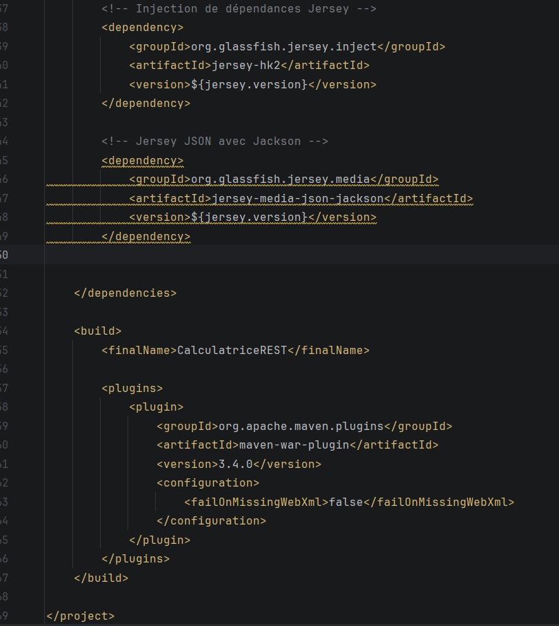

### Étape 2 : Configuration JAX-RS

La classe `RestApplication` étend `jakarta.ws.rs.core.Application` et porte l'annotation `@ApplicationPath("/api")`. Cette seule annotation active JAX-RS et fixe la racine de toutes les URI REST. Avant Jakarta EE 9, il fallait déclarer la servlet Jersey à la main dans `web.xml` ; ce n'est plus nécessaire.

**Capture : `RestApplication.java`**


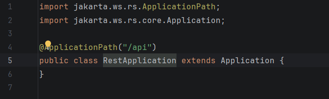

### Étape 3 : Classe métier `Calculatrice`

Classe Java simple, **indépendante de REST**, avec quatre méthodes : `somme`, `difference`, `produit` et `division`. La division lève une `IllegalArgumentException` si le diviseur vaut 0.

**Capture : `Calculatrice.java`**

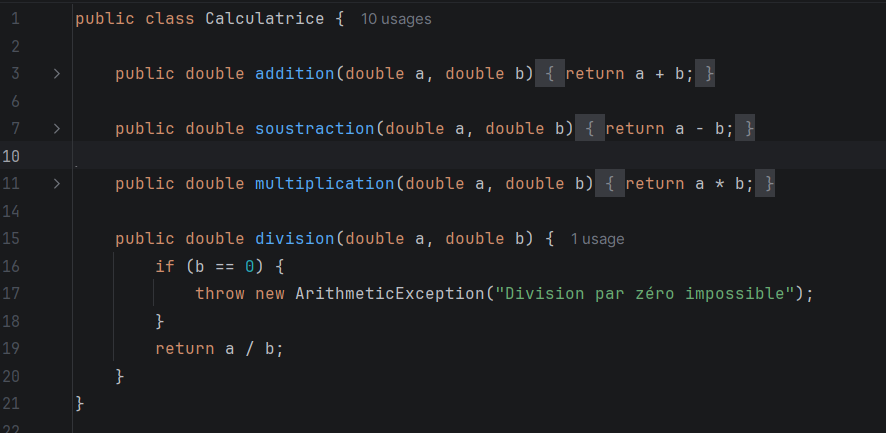

### Étape 4 : Modèle JSON `Operation`

Classe qui représente la ressource renvoyée, avec quatre attributs : `a`, `b`, `op` (symbole de l'opération) et `res` (résultat). Elle doit avoir un **constructeur vide**, un constructeur complet et des **getters/setters** : c'est ce qui permet à Jersey de la convertir en JSON.

**Capture : `Operation.java`**

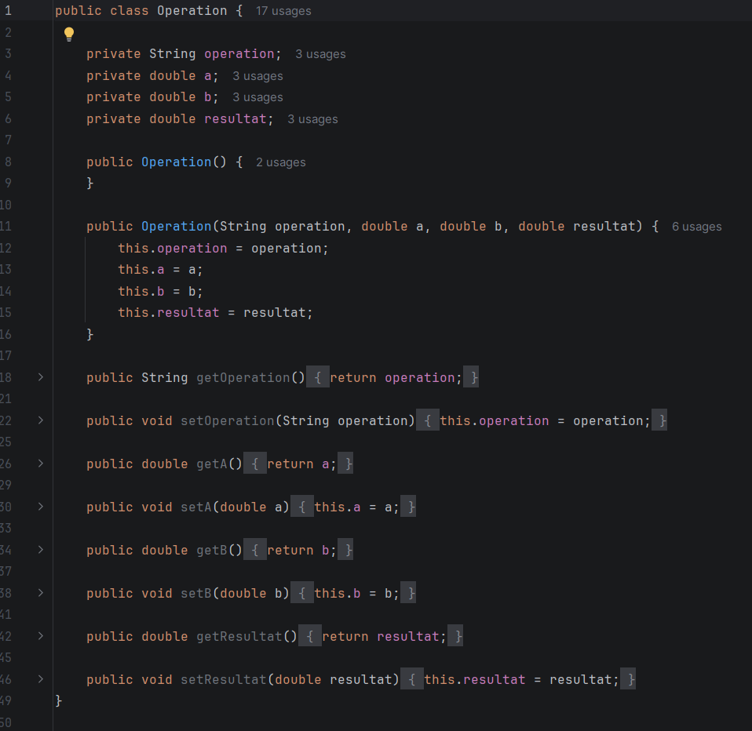

### Étape 5 : Ressource REST `CalculRest`

Classe annotée `@Path("/calcul")` et `@Produces(MediaType.APPLICATION_JSON)`, avec quatre méthodes `@GET` : `/somme`, `/difference`, `/produit` et `/division`. Chaque méthode lit `a` et `b` avec `@QueryParam`, appelle `Calculatrice` et renvoie un objet `Operation`. La division renvoie un `Response` avec le statut **400** si `b == 0`.

| Annotation | Rôle |
|---|---|
| `@ApplicationPath("/api")` | Racine de toutes les URI REST |
| `@Path("/calcul")` | URI de la classe ressource |
| `@Path("/somme")` | URI de la méthode (s'ajoute à celle de la classe) |
| `@GET` | Méthode HTTP gérée |
| `@QueryParam("a")` | Récupère le paramètre `?a=...` |
| `@Produces(JSON)` | Format de la réponse (`Content-Type`) |

**Construction de l'URL finale**

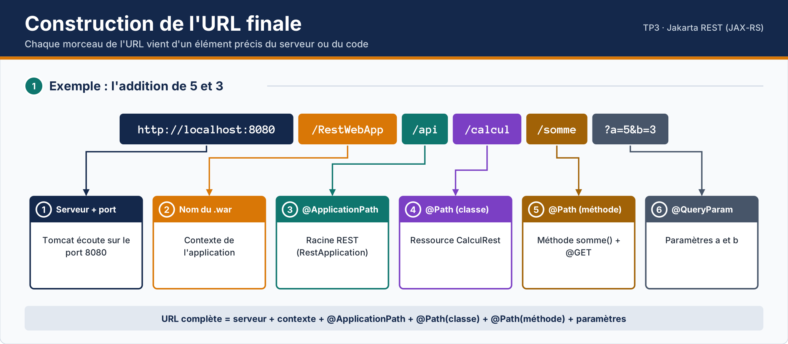

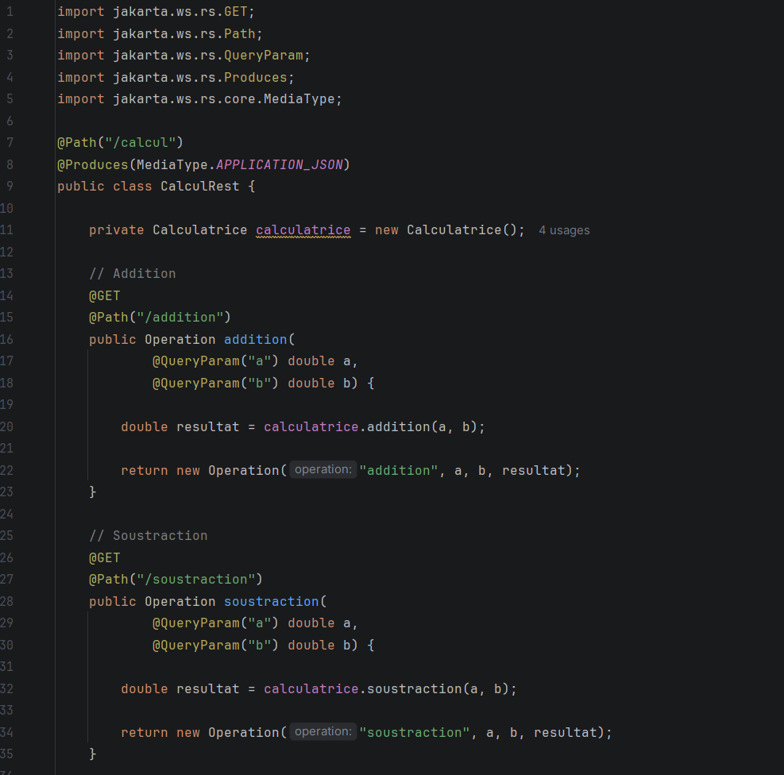

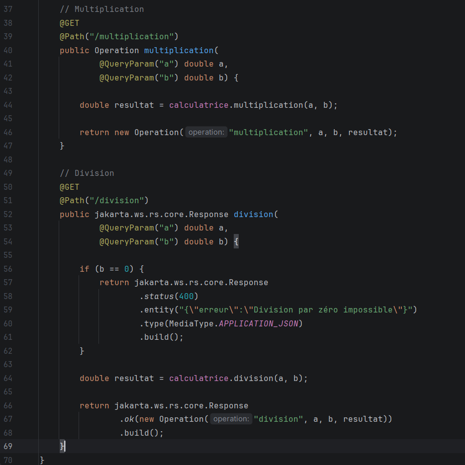

### Étape 6 : Déploiement sur Tomcat

1. Générer le `.war` : `mvn clean package`.
2. Copier `target/CalculatriceREST.war` dans le dossier `webapps` de Tomcat.
3. Démarrer Tomcat avec `bin/startup.sh` (Linux/macOS) ou `bin\startup.bat` (Windows).
4. Vérifier dans les logs (`logs/catalina.out`) que `CalculatriceREST.war` est bien déployé.

### Étape 7 : Tests Postman

Voir la [section 8](#8-tests-postman).

---

## 7. Description de l'API

**URL de base** : `http://localhost:8080/CalculatriceREST/api`

| Opération | Méthode | URI | Paramètres | Réponse |
|---|---|---|---|---|
| Addition | GET | `/calcul/somme` | `a`, `b` (nombres) | `Operation` JSON, `op` = `+` |
| Soustraction | GET | `/calcul/difference` | `a`, `b` | `Operation` JSON, `op` = `-` |
| Multiplication | GET | `/calcul/produit` | `a`, `b` | `Operation` JSON, `op` = `*` |
| Division | GET | `/calcul/division` | `a`, `b` (`b ≠ 0`) | `Operation` JSON, `op` = `/` |

### Codes de statut

| Code | Signification | Cas |
|---|---|---|
| `200 OK` | Succès | Calcul effectué |
| `400 Bad Request` | Requête invalide | Division par zéro |
| `404 Not Found` | Ressource inconnue | URI mal écrite |
| `405 Method Not Allowed` | Verbe non supporté | POST sur `/somme` |

### Format de réponse

```json
{
  "a": 5.0,
  "b": 3.0,
  "op": "+",
  "res": 8.0
}
```

---

## 8. Tests Postman

Pour chaque test : méthode `GET`, URL dans la barre d'adresse, clic sur *Send*. Les captures doivent montrer l'URL, le statut et le corps JSON.

### 8.1 Addition

`GET http://localhost:8080/CalculatriceREST/api/calcul/addition?a=10&b=5` → `res: 15.0`

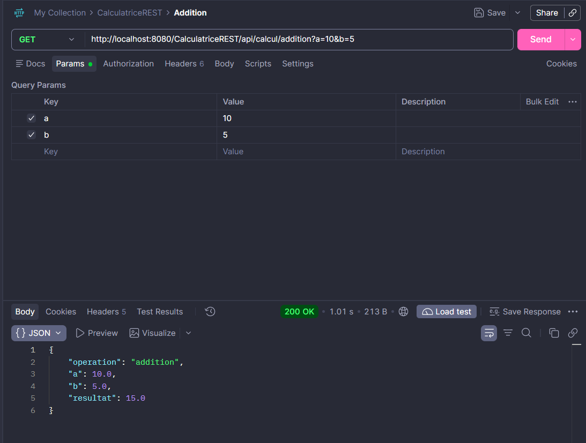

### 8.2 Soustraction

`GET http://localhost:8080/CalculatriceREST/api/calcul/soustraction?a=10&b=5` → `res: 5.0`

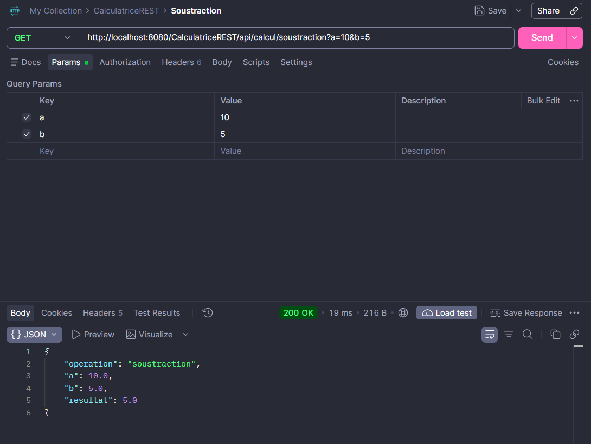

### 8.3 Multiplication

`GET http://localhost:8080/CalculatriceREST/api/calcul/multiplication?a=10&b=5` → `res: 50.0`

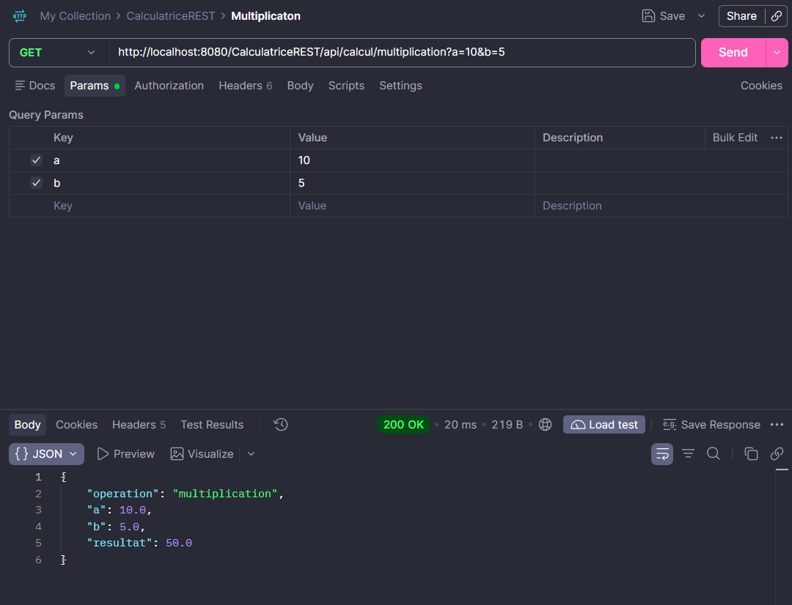

### 8.4 Division

`GET http://localhost:8080/CalculatriceREST/api/calcul/division?a=10&b=5` → `res: 2.0`

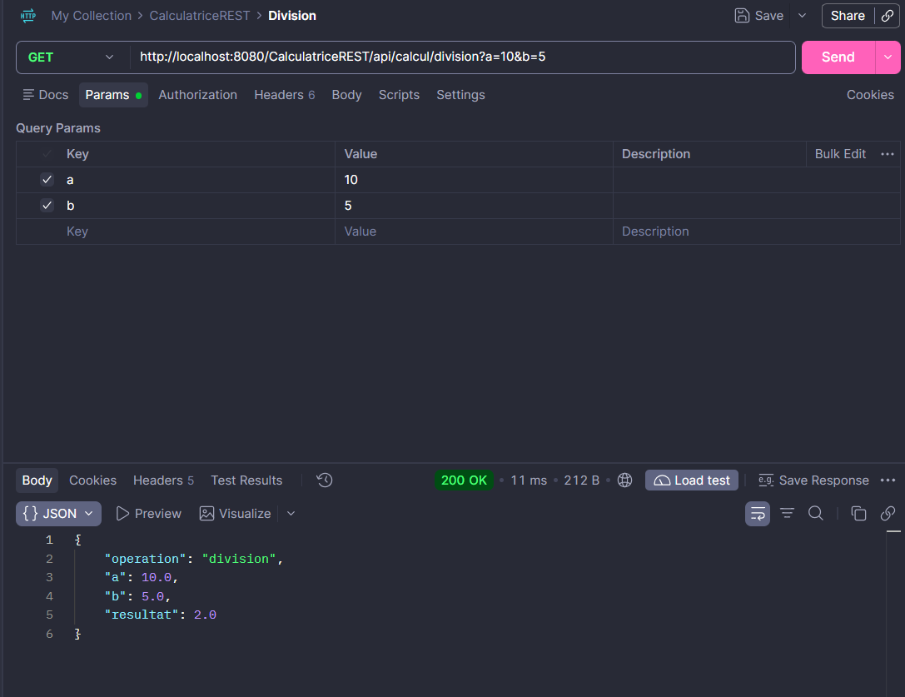

### 8.5 Cas d'erreur : division par zéro

`GET http://localhost:8080/CalculatriceREST/api/calcul/division?a=10&b=0` → statut `400`

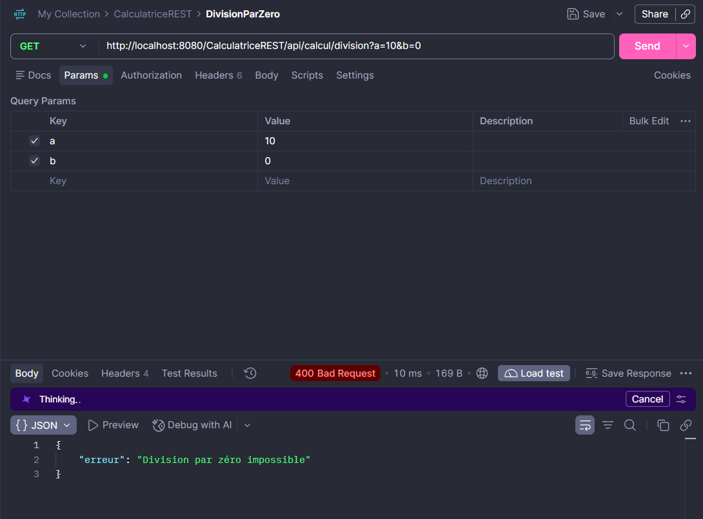

---

## 9. Conclusion

Ce TP a permis de concevoir et de déployer un service REST de calculatrice avec **JAX-RS** et **Jersey**, dans un projet **Maven** packagé en `.war` et exécuté sur **Tomcat 10.1**. Les quatre opérations sont exposées en `GET` sous `/api/calcul`, avec des réponses en **JSON** et une gestion d'erreur (statut `400` pour la division par zéro).

Les tests Postman ont confirmé le bon fonctionnement de chaque endpoint. Le TP a aussi montré le rôle de chaque composant : Tomcat gère le HTTP, Jersey fait le lien avec les annotations JAX-RS, et la logique métier reste séparée de la couche REST.

Pour aller plus loin, on pourrait ajouter d'autres verbes HTTP (`POST`, `PUT`, `DELETE`), une base de données, ou une documentation de l'API avec OpenAPI/Swagger.
